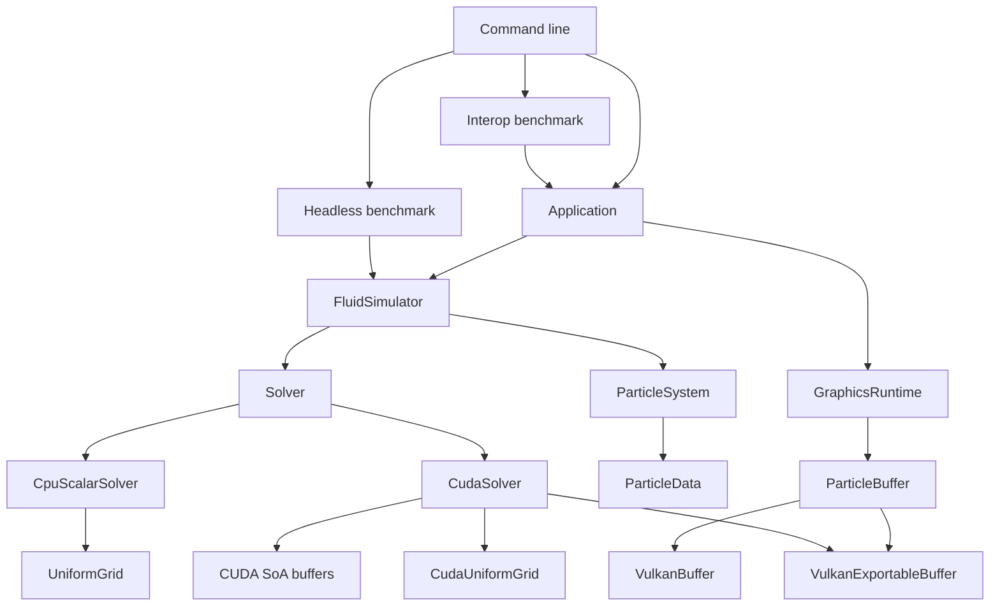

# Fluid Simulator

Fluid Simulator is an early-stage 3D particle fluid simulator written in
C++20 and CUDA. The application runs an SPH simulation on an OpenMP CPU
backend or a CUDA backend, uses a Uniform Grid for neighbor lookup, and renders
the particles as Vulkan point sprites in a GLFW window.

> **Project status:** the CPU and CUDA simulation backends and Vulkan rendering
> path are functional, but the application is still experimental. CUDA can
> render through either the host-transfer path or an explicitly enabled
> Vulkan/CUDA external-memory path.

## Demo

https://github.com/user-attachments/assets/5d53c393-3607-4f4b-9a94-7fd8b020c329

## Current features

- Smoothed Particle Hydrodynamics (SPH) with density/pressure, force, and
  integration passes.
- Structure-of-Arrays (SoA) storage for particle positions and velocities.
- A scalar CPU backend with OpenMP parallelization and a flat Uniform Grid that
  restricts neighbor queries to the 27 cells around a particle.
- A CUDA backend with a GPU Uniform Grid and separate density/pressure,
  acceleration, and integration/collision kernels.
- Persistent CUDA SoA allocations, with either explicit host transfers or an
  optional Vulkan/CUDA rendering path using exported memory and timeline
  semaphores.
- Axis-aligned box collision handling.
- Vulkan rendering with a depth buffer, two frames in flight, synchronized
  per-frame particle buffers, and swapchain recreation on resize.
- GLSL vertex and fragment shaders compiled to SPIR-V by CMake.
- Runtime selection between the CPU and CUDA simulation backends.
- A headless benchmark for simulation updates and a graphical benchmark that
  compares CUDA rendering with and without Vulkan/CUDA interoperability.
- A smoke-test mode that exercises rendering, window resize, swapchain
  recreation, and clean shutdown.

The application currently initializes 100,000 particles, matching the default
particle and rendering capacity.

## Build

### Prerequisites

- CMake 3.24 or newer
- A C++20 compiler
- Vulkan headers and loader
- A Vulkan-capable driver and device with swapchain and `largePoints` support
- GLFW 3.3 or newer
- GLM with a CMake package configuration
- OpenMP support for the selected compiler
- CUDA Toolkit with `nvcc`
- A CUDA-capable NVIDIA GPU with a compatible driver
- `glslc`, supplied by the Vulkan SDK or a Shaderc package

CMake must be able to locate Vulkan, GLFW, GLM, and OpenMP through
`find_package`. The project enables both C++ and CUDA languages, so the CUDA
Toolkit and `nvcc` must also be discoverable during configuration. If `glslc`
is not on `PATH`, set `VULKAN_SDK` so CMake can find it in `$VULKAN_SDK/bin`.
CUDA is currently enabled unconditionally; there is no CPU-only CMake option.

The repository does not define a CI or platform support matrix. The code uses
CMake, GLFW, Vulkan, OpenMP, and CUDA; the commands below assume a Unix-like
desktop environment with working Vulkan surface support and an NVIDIA CUDA
toolchain and device.

### Release build

```sh
cmake -S . -B build -DCMAKE_BUILD_TYPE=Release
cmake --build build -j
```

The build creates `build/fluid-simulator`. CMake also compiles
`shaders/particle.vert` and `shaders/particle.frag` into
`build/shaders/*.spv`; no separate shader command is required.

### Debug build

```sh
cmake -S . -B build-debug -DCMAKE_BUILD_TYPE=Debug
cmake --build build-debug -j
```

Debug builds request the `VK_LAYER_KHRONOS_validation` layer and Vulkan debug
utilities. If either is unavailable, the application prints a warning and
continues without validation.

## Run

```sh
./build/fluid-simulator
./build/fluid-simulator --backend cpu
./build/fluid-simulator --backend cuda
./build/fluid-simulator --interop
./build/fluid-simulator --backend cuda --interop
```

CUDA is the default backend. In normal GUI mode, Vulkan/CUDA interoperability
is disabled unless `--interop` is supplied. Without it, CUDA copies simulation
results back to the host and uses the normal Vulkan upload path. With it, CUDA
writes active positions directly into an exported Vulkan vertex buffer.
`--interop` is ignored when the CPU backend is selected.

The window can be resized or closed through the window manager. There are no
keyboard, mouse, or runtime parameter controls yet; initialization defaults
are defined by the C++ configuration structs.

Use `-h` or `--help` to list the supported command-line options:

```sh
./build/fluid-simulator --help
```

### Headless benchmark

```sh
./build/fluid-simulator --benchmark
./build/fluid-simulator --benchmark --backend cpu
./build/fluid-simulator --benchmark --backend cuda
```

Benchmark mode bypasses the application, GLFW, and Vulkan. It initializes the
same particle system and selected simulation backend as GUI mode, runs 100
warmup steps followed by 1,000 measured steps, and measures the complete
simulation update path. CUDA results therefore include the host/device copies
performed by the non-interop solver path. The output reports total time,
average time per step, steps per second, and particles processed per second.
CUDA remains the default backend when `--backend` is omitted. Supplying
`--interop` does not change this headless mode or initialize Vulkan.

### CUDA/Vulkan rendering benchmark

```sh
./build/fluid-simulator --benchmark-interop
```

This graphical benchmark implies the CUDA backend and creates two fresh
application instances: one using the host-transfer rendering path and one
using Vulkan/CUDA interoperability. Each run uses the same initial state, 100
warmup frames, and 1,000 measured frames. It reports average, median, minimum,
and maximum frame time, FPS, and the relative difference between both paths.

The benchmark requires a working display, Vulkan presentation, and CUDA.
`MAILBOX` is preferred; the `FIFO` fallback may make results VSync-limited.
`--benchmark-interop` cannot be combined with `--benchmark` or `--smoke-test`.

For an automated graphical smoke test:

```sh
./build/fluid-simulator --smoke-test
```

This mode resizes the window after 30 rendered frames and closes it after 90.
It still requires a working display, Vulkan loader, driver, and presentation
surface; it is not a headless unit test. Add `--interop` to exercise the CUDA
interop rendering path during the smoke test.

## Architecture



`Application` is the top-level owner of the simulation and rendering systems.
It contains the `FluidSimulator`, the intermediate `ParticleVertex` staging
storage, and the `GraphicsRuntime`.

`FluidSimulator` owns both the `ParticleSystem` and the active `Solver`. The
particle system owns the simulation data in a Structure of Arrays
(`ParticleData`) layout, while simulation steps are delegated through the
abstract `Solver` interface. Both `CpuScalarSolver` and `CudaSolver` implement
this interface. `SimulationConfig` selects the backend for both GUI and
benchmark modes; CUDA is the default and `--backend cpu` selects the CPU
implementation. The CPU and CUDA implementations each own their corresponding
Uniform Grid.

Without interoperability, active positions are copied back from CUDA, packed
as `ParticleVertex` data by `Application`, and uploaded through the normal
`ParticleBuffer` path. With interoperability, CUDA keeps the simulation SoA
resident and packs positions directly into the per-frame exported Vulkan
buffer; Vulkan and CUDA coordinate access with an external timeline semaphore.

See [Architecture](docs/architecture.md) for the Vulkan runtime and resource
flow, and [Simulation](docs/simulation.md) for the SPH pipeline, SoA particle
layout, Uniform Grid, simulation parameters, and CPU/CUDA execution models.
Recorded performance measurements are kept in
[Benchmark History](docs/benchmarks.md).

## Repository layout

```text
include/app/                 Application interface
include/benchmark/           Simulation and rendering benchmark interfaces
include/backends/cpu/        Scalar CPU solver interface
include/backends/cuda/       CUDA solver and Uniform Grid interfaces
include/core/                Camera and frame timer
include/graphics/vulkan/     Vulkan renderer interfaces
include/simulation/          Backend-independent simulation types
include/config.hpp           Application and simulation configuration defaults
src/                         Implementations matching the include tree
shaders/                     GLSL particle shaders
docs/                        Architecture and simulation documentation
CMakeLists.txt               Build and shader compilation configuration
```

## Development

CMake exports `build/compile_commands.json` automatically. The checked-in
VS Code settings point clangd at `build`, and `.clang-format` defines the C/C++
formatting style.

Format a changed file with:

```sh
clang-format -i path/to/file.cpp
```

GNU and Clang builds enable `-Wall`, `-Wextra`, `-Wpedantic`, `-Wshadow`, and
`-Wconversion`. The repository currently has no test target. Its benchmarks
are runtime modes of the main executable rather than separate targets or a
suite.

## Current limitations

- The backend is selected at startup; there is no live backend switching.
- CUDA without interoperability uses synchronous host/device transfers on
  every simulation step.
- Vulkan/CUDA physical-device UUID matching and automatic external-resource
  capability probing are not implemented.
- Interoperability is Linux/NVIDIA-oriented and uses `OPAQUE_FD` handles.
  When explicitly requested, initialization/import failure is reported rather
  than falling back automatically.
- Main initialization values are centralized in C++ configuration structs, but
  there is no external configuration file or general CLI parameter tuning.
- The simulation performs one step per rendered frame and caps that step at
  1 ms; it has no fixed-step accumulator or substepping controller.
- The renderer displays fixed-size, single-color point sprites rather than a
  reconstructed fluid surface.
- There are no interactive controls or automated numerical tests.
